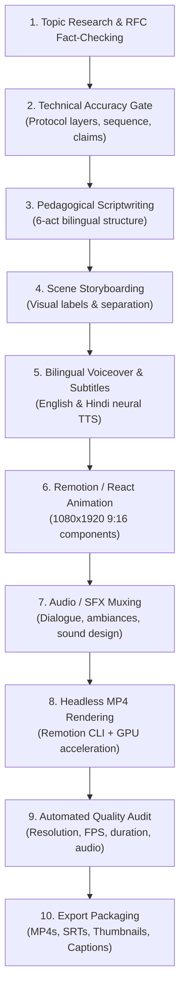

# RTechLab Animated Explainer Engine — Production Skill (V3 Master Standard)

This skill guides Google Antigravity agents through producing broadcast-quality, vertical educational videos ($1080 \times 1920$ @ 30 FPS) for RTechLab.

Videos follow two original visual styles:
- **Style A (Cinematic Animated Storytelling)**: 3D tech environments, isometric data centers, stylized network topologies, dynamic lighting, and cinematic camera sweeps.
- **Style B (Technical Motion Graphics)**: Precise packet flows, protocol packet headers, interactive network switches/routers, binary/hex grids, and terminal HUDs.

---

## 1. Production Pipeline Overview & Technical Accuracy Gate

Every video progresses through an enhanced 10-gate pipeline featuring a mandatory **Technical Accuracy Gate**:

---

## 2. Mandatory Technical Accuracy Standards (V3 Upgrade)

1. **Strict Protocol Layer Separation**:
   - **Stage 1 (DNS Resolution)**: Resolves FQDN to an IP address (`A` or `AAAA` record) over UDP/TCP port 53 or DoH. Once the IP is delivered, display:
     `✓ DNS RESOLUTION COMPLETE`
   - **Stage 2 (Browser Connection)**: The browser initiates a completely separate transport connection (TCP 3-way handshake or QUIC) followed by the TLS 1.3 cryptographic security handshake.
   - **Rule**: Never depict TLS as part of DNS resolution. DNS does not transport web data.
2. **Cold-Cache vs. Cached Lookups**:
   - Always display the label `[ COLD-CACHE EXAMPLE ]` or `[ ILLUSTRATIVE WALKTHROUGH ]` when demonstrating full multi-tier root/TLD/authoritative traversals.
   - Clarify that in production networks, recursive resolvers cache intermediate delegation records (NS/TLD), answering repeated queries directly without contacting root servers.
   - Never cite speculative universal cache-hit percentages.
3. **Latency & Performance Claims**:
   - Remove all guaranteed latency statements (e.g. "under 50ms", "<1ms guaranteed").
   - Any figure shown must be explicitly qualified as an *illustrative benchmark* with conditions specified (e.g. `*Illustrative network benchmark: Latency varies by distance and routing conditions`).
4. **Brand & Domain Safety**:
   - Do not display unverified custom domain URLs. Use verified branding and social handles (e.g. `@RTechLab` / `youtube.com/@RTechLab`) until production domain DNS records are confirmed.

---

## 3. 60–75s Pedagogical Story Arc

Every explainer video adheres strictly to the attention-retaining pedagogical curve:

| Time Interval | Frame Range (@30fps) | Purpose | Required Visual & Audio Elements |
| :--- | :--- | :--- | :--- |
| **Act 1: Hook** | `0` – `150` | **Curiosity Trigger** | High-energy question. What happens between entering a domain and the page loading? |
| **Act 2: Problem** | `150` – `550` | **Names vs. Numbers** | Contrast human mnemonic names with machine numerical routing (IPv4/IPv6). |
| **Act 3: Mechanism** | `550` – `1250` | **Stage 1: DNS Resolution** | Cold-cache walk: Cache lookup $\to$ Recursive Resolver $\to$ Root $\to$ TLD $\to$ Auth NS $\to$ `DNS RESOLUTION COMPLETE`. |
| **Act 4: Connection** | `1250` – `1600` | **Stage 2: Connection** | Separate post-DNS phase: TCP/QUIC transport session + TLS 1.3 encryption handshake. |
| **Act 5: Summary** | `1600` – `1750` | **Core Takeaway** | 3 Architectural Rules: Directory not transport, hierarchical delegations, caching. |
| **Act 6: Brand CTA** | `1750` – End | **RTechLab Outro** | Glowing emblem, `Follow @RTechLab`, interactive tools CTA. |

---

## 4. Bilingual Content Standard

Each chapter is generated in both **English** and **Hindi**:
- **Preserved Technical Vocabulary**: Never transliterate standard engineering terms into unreadable literal words. Retain `Router`, `Switch`, `Packet`, `IP Address`, `DNS Resolver`, `Authoritative Server`, `Subnet Mask`, `Port`, and `Firewall` cleanly.
- **English Voice**: `en-US-ChristopherNeural` (Rate: `+12%`).
- **Hindi Voice**: `hi-IN-MadhurNeural` (Rate: `+24%`).
- **Independent Duration Parity**: Natural educational cadence is prioritized. Hindi may extend appropriately (e.g. ~75s) without artificially squeezing content.
- **Subtitles**: Export `.srt` and `.vtt` with exact millisecond timestamps and render animated on-screen caption pills within platform-safe margins ($Y \approx 1520\text{px}$, leaving bottom $380\text{px}$ clear).

---

## 5. Visual Identity & Brand Styling

- **Canvas Background**: Deep space navy `#080d1a` to dark graphite `#0f172a`.
- **Primary Accents**:
  - Cyan Neon: `#00f2fe` / `#06b6d4` (client, query requests)
  - Electric Violet: `#6366f1` / `#8b5cf6` (resolvers, intermediate processing)
  - Emerald Green: `#10b981` (DNS resolution complete, verified IP, security OK)
  - Amber Gold: `#f59e0b` (cold-cache indicator, notices)
  - Crimson Rose: `#ef4444` (cache miss, packet drops)
- **Typography**: `Plus Jakarta Sans` for titles/body, `JetBrains Mono` for IP addresses, terminal outputs, and protocol badges.

---

## 6. Directory References

- V3 Compositions: `video-engine/src/compositions/DnsExplainerV3.jsx`
- V3 Reusable Scenes: `video-engine/src/components/scenes_v3/`
- Audio Synthesis: `.agents/skills/rtechlab-animated-explainer/scripts/generate_narration.py`
- Quality Verification: `.agents/skills/rtechlab-animated-explainer/scripts/verify_video_quality.py`
- Output Directory: `video-engine/out/` (V1 preserved, V3 exported cleanly)
