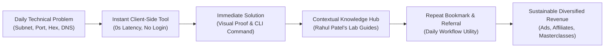
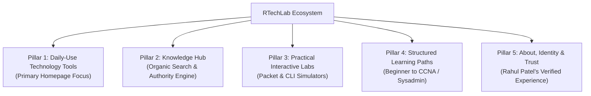
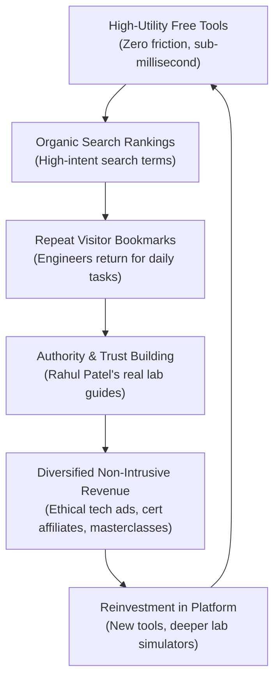

# RTechLab — Long-Term Business Strategy
## The International Daily-Use Technology Platform | Vision V1

---

## 1. Executive Vision & Core Philosophy

RTechLab is evolving from a technical tutorial site into an **international, daily-use technology utility and practical engineering platform**. 

The modern technology internet is flooded with two extremes:
1. **Generic AI-generated SaaS landing pages** that offer vague promises, excessive marketing copy, and hollow dashboards.
2. **Aggressive ad-bloated conversion sites** that hide tools behind popups, forced registrations, or paywalls.

RTechLab's strategic mission is fundamentally different:
> **"Technology Made Practical."**  
> Deliver instant, browser-native utility for everyday technical tasks (subnetting, DNS inspection, binary conversion, port lookups, permission calculating) backed by authoritative, zero-fluff engineering knowledge from Rahul Patel.

---

## 2. The ILovePDF Analogy: Applying High-Utility UX to Infrastructure Tech

Our inspiration for user experience is **ILovePDF**:
- **Tool-First Architecture**: When a user visits the homepage, 90% of the screen is dedicated to clear, self-explanatory utility cards. There is no massive self-aggrandizing hero section or decorative corporate animation.
- **Immediate Value**: Tools require zero clicks to understand and zero registration friction to use.
- **Categorical Clarity**: Every tool is neatly organized by workflow domain.
- **Repeat Utility**: People use ILovePDF weekly because everyday document tasks are recurring. Similarly, engineers and students calculate subnets, verify DNS records, convert hex values, and check port numbers daily.

### How RTechLab Adapts This to Technology:
Unlike generic PDF tools, technology infrastructure tools require **technical accuracy, mathematical proof, and contextual explanation**. 

When an engineer uses RTechLab's Subnet Calculator:
1. They get the **instant mathematical allocation** (Network, Broadcast, Usable Range, Wildcard).
2. They get the **exact Cisco IOS / Linux command snippet** (`ip address 192.168.1.1 255.255.255.0`).
3. They get an optional one-click link to **Rahul Patel's VLSM Architecture Blueprint** to understand *why* the subnet works.

---

## 3. The Five Product Pillars

### Pillar 1: Daily-Use Technology Tools (Primary Homepage Focus)
- **Role**: High-frequency utility and direct organic search entry point.
- **Design**: Instant browser execution, 100% client-side (zero server latency, zero data collection).
- **Core Domains**: Networking, IP & DNS, Developer & Numbers, System Administration, Cybersecurity.

### Pillar 2: Knowledge Hub (SEO Content & Education Engine)
- **Role**: Organic discovery and long-tail technical authority.
- **Content Standard**: Written from real lab and classroom experience by Rahul Patel. Every article includes reproducible terminal commands, packet capture analysis, architecture diagrams, and related tools.
- **No Thin AI Content**: Every piece must solve a concrete engineering problem that standard documentation fails to clarify simply.

### Pillar 3: Practical Interactive Labs
- **Role**: Deep engagement and bridge from theory to practice.
- **Differentiator**: In-browser simulators (DNS step-by-step resolution, packet encapsulation walkthroughs, Linux shell simulator) that clearly distinguish visual simulations from real OS environments.

### Pillar 4: Structured Learning Paths
- **Role**: Retention and user progression.
- **Architecture**: Step-by-step tracks (e.g. *Zero to Subnetting Master*, *CCNA Enterprise Core*, *Linux Sysadmin Foundations*) that weave together tools, tutorials, and practice exercises.

### Pillar 5: About, Identity & Trust
- **Role**: E-E-A-T (Experience, Expertise, Authoritativeness, Trustworthiness).
- **Standard**: Transparent disclosure of authorship, methodology, zero fake social proof, zero fake user statistics, and clear editorial standards.

---

## 4. Target Audience Segments & Value Proposition

| Audience Segment | Primary Daily Need | Why They Choose RTechLab | Repeat Usage Frequency |
| :--- | :--- | :--- | :--- |
| **Enterprise Network Engineers** | Fast subnet calculation, CIDR/Wildcard validation, Port lookups | Clean, fast, zero login, no annoying ads blocking input fields | 3–5 times per week |
| **Indian Students & CCNA Aspirants** | Exam prep, subnetting shortcuts, bilingual (EN + HI) explanations | Clear mental models, native Hindi explanations of complex RFC concepts | Daily during study cycles |
| **Linux & Cloud Administrators** | File permissions (chmod) calculation, JSON formatting, IP range planning | Instant client-side execution, security-first privacy (no data leaves browser) | 2–4 times per week |
| **Cybersecurity Learners** | Base64/Hex encoding, port security references, hash verification | Educational breakdown of protocols without malware/shady ads | 1–3 times per week |
| **Developers & Tech Enthusiasts** | DNS propagation check, bandwidth estimators, regex testing | Direct bookmarks, uncluttered dark-mode UI, mobile responsiveness | Weekly |

---

## 5. Sustainable Business Model: Value Flywheel

### Business Principles:
1. **Tools Remain Genuinely Free**: Free tools are never artificially crippled to force upgrades. A subnet calculator that only calculates 3 times before asking for email is an insult to engineers.
2. **Privacy as a Feature**: Client-side execution means sensitive enterprise IP plans or hashes are never transmitted to RTechLab servers.
3. **Monetization Respects Usability**: Ads and affiliate recommendations must never interfere with tool operation.
4. **No Unrealistic Revenue Claims**: Growth is modeled on compounding organic utility, not get-rich-quick traffic arbitrage.

---

## 6. Strategic Milestones & Measurable KPIs

| Timeframe | Platform Focus | Primary Measurable Objective | KPI Targets |
| :--- | :--- | :--- | :--- |
| **Months 1–3** | **Tool-First Transformation** | Complete homepage refactor to tool-first grid; deploy 5 new client-side tools. | Core Web Vitals all green; 0s CLS; 100% client-side privacy. |
| **Months 4–6** | **Search Footprint Expansion** | Optimize dedicated tool pages; establish topic clusters linking tools to 24 tutorials. | Indexing of all tool pages; > 30% organic click growth. |
| **Months 7–9** | **Retention & Labs Engine** | Launch interactive learning paths and DNS visual resolution lab simulator. | Average session duration > 2m 30s; repeat visitor rate > 25%. |
| **Months 10–12** | **Monetization Validation** | Test privacy-first ethical display ads and relevant certification study partnerships. | Revenue per thousand visitors (RPM) stabilized; zero negative UX impact. |

---

## 7. Strategic Conclusion

RTechLab's sustainable advantage lies at the intersection of **utility** and **authority**:
- Generic tool websites lack the educational credibility to retain learners.
- Traditional educational blogs lack the interactive utilities that bring users back every single day.

By unifying both under a clean, tool-first interface backed by Rahul Patel's genuine technical expertise, RTechLab builds a durable, compounding international asset.
