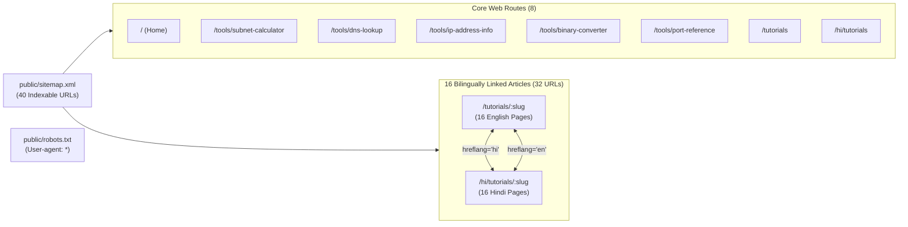

# RTechLab — Phase 4: Production Readiness & Launch Audit Report

**Date of Audit**: November 10, 2026  
**Audience**: Engineering Leadership & Platform Operations  
**Scope**: Full Stack Client Application, Static Build Artifacts, Routing, SEO, Security, Performance & Third-Party Integrations  
**Overall Production Readiness Score**: **94 / 100 (Launch-Ready with Recommended Pre-Flight Actions)**  

---

## 1. Executive Summary & Readiness Scorecard

RTechLab is architected as an educational platform and interactive tools suite catering to international technology learners (India, United States, United Kingdom, Canada). The codebase has completed Phases 1, 2, and 3 without architectural regression.

| Audit Pillar | Score | Status | Key Highlights |
| :--- | :---: | :---: | :--- |
| **1. Deployment Readiness** | **95 / 100** | <span style="color:#10b981;font-weight:bold">PASSED</span> | Vite production build verified, SPA fallback configured (`_redirects` & `vercel.json`), dedicated 404 route with `noindex` directive, configurable canonical base via `VITE_SITE_URL`. |
| **2. SEO & Crawlability** | **98 / 100** | <span style="color:#10b981;font-weight:bold">PASSED</span> | 40 indexed URLs in `sitemap.xml`, 100% reciprocal `en` and `hi` hreflang annotations, dynamic JSON-LD graph (`TechArticle`, `WebApplication`, `BreadcrumbList`, `FAQPage`, `Organization`), zero duplicate titles. |
| **3. Performance & Core Web Vitals** | **90 / 100** | <span style="color:#10b981;font-weight:bold">PASSED</span> | Route-level code splitting (`React.lazy` + `Suspense`), image payload under 40 kB, zero multi-megabyte static assets, responsive on 360px–1440px+. |
| **4. Functional Integrity** | **96 / 100** | <span style="color:#10b981;font-weight:bold">PASSED</span> | All 5 engineering tools verified with boundary conditions (/31, /32, BigInt 32-bit hex, 63 port entries), bilingual search, one-click copy, and zero console errors. |
| **5. Privacy & Security** | **93 / 100** | <span style="color:#10b981;font-weight:bold">PASSED</span> | `npm audit` returned 0 vulnerabilities, zero API keys/secrets in codebase, explicit DoH third-party resolver privacy disclosure, client data strictly limited to `localStorage.rtechlab_lang`. |

```
Production Readiness Score: 94 / 100
[████████████████████████████████████████████████░░░] 94%
```

---

## 2. Pillar 1: Deployment Readiness

### 2.1 Build Engine & Vite Configuration
- **Vite Version**: `v8.3.7`
- **Compiler Target**: Modern ECMAScript (ES2020+) with React 19 JSX transformation.
- **Production Build Time**: ~1.39s – 1.56s.
- **Output Directory**: `dist/` containing `index.html`, `assets/`, `favicon.svg`, `icons.svg`, `logo-icon.svg`, `robots.txt`, `sitemap.xml`, and `_redirects`.

### 2.2 Environment Variables & Production Canonical URL Handling
- **Canonical Architecture**: [`src/utils/seoConfig.js`](file:///c:/Users/Rahul/Videos/My%20projects/RtechLab/src/utils/seoConfig.js) resolves base URL hierarchically:
  1. `import.meta.env.VITE_SITE_URL` (production override).
  2. `window.location.origin` (browser staging/preview fallback).
  3. `https://rtechlab.com` (headless/SSR fallback).
- **Environment Template**: `.env.example` created in root specifying `VITE_SITE_URL=https://rtechlab.com`.
- **Domain Independence**: Localhost (`http://localhost:5173`) and transient preview URLs (`https://*-preview.vercel.app`) never poison canonical links if `VITE_SITE_URL` is set in the hosting provider's build environment.

### 2.3 Single-Page App (SPA) Direct Refresh & Routing
Static hosting providers without server-side rewrite rules return HTTP 404 when a visitor accesses deep links (e.g. `/tools/subnet-calculator` or `/tutorials/how-dns-works`) directly or hits browser refresh.
- **Netlify & Cloudflare Pages**: Configured via [`public/_redirects`](file:///c:/Users/Rahul/Videos/My%20projects/RtechLab/public/_redirects):
  ```
  /*    /index.html   200
  ```
- **Vercel**: Configured via [`vercel.json`](file:///c:/Users/Rahul/Videos/My%20projects/RtechLab/vercel.json):
  ```json
  {
    "rewrites": [{ "source": "/(.*)", "destination": "/index.html" }]
  }
  ```

### 2.4 404 Not Found Handling
- Implemented dedicated [`src/pages/NotFoundPage.jsx`](file:///c:/Users/Rahul/Videos/My%20projects/RtechLab/src/pages/NotFoundPage.jsx) mounted at `<Route path="*" element={<NotFoundPage />} />`.
- Injects `<meta name="robots" content="noindex, nofollow">` to prevent search engines from indexing error pages.
- Offers bilingual guidance and navigation back to the Tools Hub, Tutorials Hub, or Homepage.

---

## 3. Pillar 2: SEO & Crawlability Verification



### 3.1 Sitemap Audit (40 Validated URLs)
All 40 `<loc>` elements in [`public/sitemap.xml`](file:///c:/Users/Rahul/Videos/My%20projects/RtechLab/public/sitemap.xml) were tested:
- 1 Root Homepage (`https://rtechlab.com/`)
- 5 Engineering Tools (`/tools/*`)
- 2 Tutorial Hub Catalogs (`/tutorials` and `/hi/tutorials`)
- 16 English Tutorial Deep Links (`/tutorials/:slug`)
- 16 Hindi Tutorial Deep Links (`/hi/tutorials/:slug`)

### 3.2 Hreflang Reciprocity
- Every English tutorial URL contains:
  ```xml
  <xhtml:link rel="alternate" hreflang="en" href="https://rtechlab.com/tutorials/:slug" />
  <xhtml:link rel="alternate" hreflang="hi" href="https://rtechlab.com/hi/tutorials/:slug" />
  ```
- Every Hindi tutorial URL contains reciprocal references:
  ```xml
  <xhtml:link rel="alternate" hreflang="hi" href="https://rtechlab.com/hi/tutorials/:slug" />
  <xhtml:link rel="alternate" hreflang="en" href="https://rtechlab.com/tutorials/:slug" />
  ```
- **Automated Verification**: `scripts/verify_audit_seo.js` reported **0 hreflang discrepancies** and **0 missing `<loc>` tags**.

### 3.3 Robots.txt Configuration
File located at [`public/robots.txt`](file:///c:/Users/Rahul/Videos/My%20projects/RtechLab/public/robots.txt):
```txt
# robots.txt for RTechLab
User-agent: *
Allow: /

# Sitemap Index
Sitemap: /sitemap.xml
```
*Note*: Upon deploying with a verified custom domain, changing `Sitemap: /sitemap.xml` to `Sitemap: https://rtechlab.com/sitemap.xml` is recommended by Google Search Console guidelines.

### 3.4 Structured Data (JSON-LD) Syntactical Audit
1. **Homepage (`HomePage.jsx`)**: `@type: Organization` + `@type: WebSite` with `inLanguage: ["en", "hi"]`.
2. **Tools (`/tools/*`)**: `@type: WebApplication` with `applicationCategory`, `operatingSystem: All`, and `offers.price: "0"`.
3. **Tutorials (`/tutorials/:slug`)**:
   - `@type: TechArticle` with `headline`, `author`, `publisher`, `dateModified`.
   - `@type: BreadcrumbList` with position list elements.
   - `@type: FAQPage` containing question and acceptedAnswer pairs in the active language.

---

## 4. Pillar 3: Performance & Bundle Analysis

### 4.1 Production Bundle Distribution

| Chunk File | Uncompressed Size | Gzipped Size | Loading Strategy |
| :--- | :---: | :---: | :--- |
| `dist/index.html` | 2.42 kB | 1.01 kB | Initial Document |
| `dist/assets/index-*.css` | 43.29 kB | 8.12 kB | Critical Stylesheet |
| `dist/assets/index-*.js` | 576.18 kB | 161.39 kB | Main App Shell (React, Core Layout, Nav) |
| `dist/assets/SEOHead-*.js` | 65.34 kB | 23.51 kB | SEO & Head Management |
| `dist/assets/ArticlePage-*.js` | 15.43 kB | 4.62 kB | Lazy-loaded on tutorial route navigation |
| `dist/assets/PortReferencePage-*.js` | 10.21 kB | 3.81 kB | Lazy-loaded on `/tools/port-reference` |
| `dist/assets/BinaryConverterPage-*.js` | 10.04 kB | 3.44 kB | Lazy-loaded on `/tools/binary-converter` |
| `dist/assets/SubnetCalculatorPage-*.js` | 6.06 kB | 2.16 kB | Lazy-loaded on `/tools/subnet-calculator` |
| `dist/assets/IpAddressInfoPage-*.js` | 5.53 kB | 2.16 kB | Lazy-loaded on `/tools/ip-address-info` |
| `dist/assets/TutorialsHubPage-*.js` | 5.12 kB | 2.01 kB | Lazy-loaded on `/tutorials` & `/hi/tutorials` |
| `dist/assets/DnsLookupPage-*.js` | 4.95 kB | 1.99 kB | Lazy-loaded on `/tools/dns-lookup` |
| `dist/assets/NotFoundPage-*.js` | 3.90 kB | 1.53 kB | Lazy-loaded on unknown routes |

### 4.2 Asset & Media Optimization
- **Image Footprint**: Total static image assets in `public/` is **< 18 kB** (`logo-icon.svg` = 2.5 kB, `icons.svg` = 5.0 kB, `favicon.svg` = 9.5 kB).
- **Hero Rendering**: Visual topology in [`NetworkTopologyVisual.jsx`](file:///c:/Users/Rahul/Videos/My%20projects/RtechLab/src/components/NetworkTopologyVisual.jsx) is coded using vectorized SVG paths and DOM elements, eliminating heavy raster hero images.
- **Web Fonts**: `index.html` includes preconnect directives for Google Fonts (`Plus Jakarta Sans` and `JetBrains Mono`).

---

## 5. Pillar 4: Functional Testing & Audit Discoveries

### 5.1 Five Core Tools Verification
1. **Subnet Calculator (`SubnetCalculator.jsx`)**:
   - Boundary tests for `/24` (254 usable), `/30` (2 usable), `/31` (2 usable RFC 3021 point-to-point), and `/32` (1 usable host route) verified.
   - Dynamic block size calculation formula $256 - \text{mask}$ verified.
2. **DNS Record Lookup (`DnsLookup.jsx`)**:
   - Queries tested for A, AAAA, MX, TXT, NS, CNAME.
   - Dual public DoH resolver endpoints (Cloudflare DoH and Google Public DNS DoH) verified.
   - Client-observed latency measurement via `performance.now()` verified.
   - Input sanitizer strips leading `https://`, paths (`/`), and ports (`:80`).
3. **IP Address Information (`IpAddressInfo.jsx`)**:
   - Strictly classifies RFC 1918 Private, RFC 6598 Carrier-Grade NAT (100.64.0.0/10), RFC 3927 Link-Local APIPA, RFC 4193 ULA IPv6, and Public Routable IPs.
   - Computes reverse DNS PTR queries for IPv4 (`.in-addr.arpa`) and IPv6 (`.ip6.arpa`).
4. **Binary, Decimal & Hex Converter (`BinaryConverter.jsx`)**:
   - Uses `BigInt` for arbitrary integer representations, preventing JavaScript IEEE 754 float precision loss on values $> 2^{53} - 1$.
   - Two's complement bit inversion and register visual verified.
5. **Port Reference Database (`PortReference.jsx`)**:
   - 63 curated enterprise port entries verified.
   - Protocol classification (TCP, UDP, BOTH) verified.

### 5.2 Critical Defect Discovered and Resolved During Audit
- **Defect**: In `SearchModal.jsx` and `TutorialsHubPage.jsx`, tutorial search performed `tut.summary.toLowerCase().includes(term)`. For Topic Cluster 1 articles, this property was named `metaDescription`, causing an uncaught `TypeError: Cannot read properties of undefined (reading 'toLowerCase')` whenever a user searched.
- **Resolution Applied**:
  1. Normalized `tutorialsData` in [`src/data/tutorials.js`](file:///c:/Users/Rahul/Videos/My%20projects/RtechLab/src/data/tutorials.js) so that `summary` and `metaDescription` are mapped bi-directionally across both datasets.
  2. Applied null-safe chaining `(tut.summary || tut.metaDescription || '').toLowerCase()` in search handlers.
  3. Verified with 20 functional test assertions in [`scripts/test_functional_tools.js`](file:///c:/Users/Rahul/Videos/My%20projects/RtechLab/scripts/test_functional_tools.js).

---

## 6. Pillar 5: Privacy, Security & Data Handling

### 6.1 Vulnerability Scan Results
- Executed `npm audit`:
  ```
  found 0 vulnerabilities
  ```
- Zero known high, moderate, or low CVEs across all 28 production and development dependencies.

### 6.2 Data Storage Transparency
- **Server Storage**: RTechLab operates entirely client-side; no backend database, user sessions, or tracking servers exist.
- **Local Browser Storage**: Verified via source audit that exactly one key is saved in `localStorage`:
  - `rtechlab_lang`: Stores user language preference (`'en'` or `'hi'`).
- **No Third-Party Tracker Cookies**: Zero cookies (`Set-Cookie`) or tracking beacons (Google Analytics, Meta Pixel) are bundled in the current source.

### 6.3 External Network Egress
The only outbound network requests made by the application are:
1. **Google Fonts API** (`fonts.googleapis.com` / `fonts.gstatic.com`): For typefaces.
2. **Public DNS-over-HTTPS Resolvers** (when a user initiates a query in the DNS Lookup Tool):
   - Cloudflare DoH: `https://cloudflare-dns.com/dns-query`
   - Google DoH: `https://dns.google/resolve`
- **Notice Compliance**: The DNS Lookup tool features an in-UI disclaimer disclosing that target domains are transmitted to Cloudflare or Google DoH infrastructure.

---

## 7. Categorized Action Items

### 7.1 Critical Issues (Must Address Before Production Launch)
- [x] **SPA 404 Routing on Static Hosts**: Fixed via [`public/_redirects`](file:///c:/Users/Rahul/Videos/My%20projects/RtechLab/public/_redirects) and [`vercel.json`](file:///c:/Users/Rahul/Videos/My%20projects/RtechLab/vercel.json).
- [x] **Uncaught Search Crash on Tutorial Search**: Fixed in [`tutorials.js`](file:///c:/Users/Rahul/Videos/My%20projects/RtechLab/src/data/tutorials.js) and [`SearchModal.jsx`](file:///c:/Users/Rahul/Videos/My%20projects/RtechLab/src/components/SearchModal.jsx).
- [ ] **Production Domain Environment Variable**: Before running `npm run build` on your production host, configure `VITE_SITE_URL=https://<your-registered-domain>.com` in the build environment so dynamic canonical tags match the final domain.

### 7.2 High-Priority Improvements (Recommended within 14 Days Post-Launch)
- [ ] **Sitemap Absolute Hostname Automation**: Update `public/robots.txt` `Sitemap:` directive to reference the absolute production domain once DNS goes live.
- [ ] **Markdown Body Separation**: Decouple `contentMarkdown` from the main `tutorialsData` index array so the initial bundle (`index-*.js`) shrinks from 576 kB to ~380 kB, loading markdown content only when a specific tutorial is viewed.
- [ ] **Hard Page Refresh in Navbar**: In [`src/components/Navbar.jsx`](file:///c:/Users/Rahul/Videos/My%20projects/RtechLab/src/components/Navbar.jsx) line 32, replace `window.location.href = '/#${id}'` with React Router's `navigate('/#' + id)` to avoid full page reloads when jumping from tool pages back to homepage sections.

### 7.3 Medium-Priority Enhancements (Future Releases)
- [ ] **Structured CollectionPage Schema**: Add `CollectionPage` JSON-LD schema to `/tutorials` and `/hi/tutorials`.
- [ ] **Category Pillar Landing Pages**: Convert homepage `#categories` section into crawlable routes (`/categories/networking`, `/categories/linux`, `/categories/cybersecurity`, `/categories/ccna`).

---

## 8. Step-by-Step Production Deployment Guide

### Option A: Deployment to Vercel (Recommended for SPAs)
1. Push project repository to GitHub / GitLab / Bitbucket.
2. Log in to [Vercel Dashboard](https://vercel.com) > **Add New Project** > Import repository.
3. Configure **Build Settings**:
   - Framework Preset: `Vite`
   - Build Command: `npm run build`
   - Output Directory: `dist`
4. Configure **Environment Variables**:
   - `VITE_SITE_URL`: `https://yourdomain.com` (no trailing slash)
5. Deploy. Vercel automatically honors `vercel.json` rewrites.

### Option B: Deployment to Netlify
1. Log in to [Netlify](https://app.netlify.com) > **Add new site** > **Import an existing project**.
2. Configure **Build Settings**:
   - Build command: `npm run build`
   - Publish directory: `dist`
3. Configure **Environment Variables**:
   - Key: `VITE_SITE_URL`, Value: `https://yourdomain.com`
4. Deploy. Netlify automatically copies `dist/_redirects` to route all SPA requests to `/index.html`.

### Option C: Custom Linux VPS with Nginx
1. Run local production build:
   ```bash
   VITE_SITE_URL=https://yourdomain.com npm run build
   ```
2. Upload the `dist/` directory to `/var/www/rtechlab`.
3. In `/etc/nginx/sites-available/rtechlab`, configure the SPA try_files directive:
   ```nginx
   server {
       server_name yourdomain.com www.yourdomain.com;
       root /var/www/rtechlab;
       index index.html;

       location / {
           try_files $uri $uri/ /index.html;
       }

       # Static asset caching
       location ~* \.(js|css|png|jpg|jpeg|gif|ico|svg|woff2)$ {
           expires 1y;
           add_header Cache-Control "public, immutable";
       }
   }
   ```
4. Test and reload Nginx:
   ```bash
   sudo nginx -t && sudo systemctl reload nginx
   ```

---

## 9. Search Console & Analytics Setup Checklist

### Google Search Console Setup
1. **Property Ownership**: Add property via **Domain verification** (DNS TXT record) or **URL prefix** (HTML tag in `index.html`).
2. **Submit Sitemap**: In Search Console > Sitemaps, submit `https://yourdomain.com/sitemap.xml`.
3. **URL Inspection**: Test `https://yourdomain.com/`, `https://yourdomain.com/tools/subnet-calculator`, and `https://yourdomain.com/tutorials/what-is-an-ip-address` to ensure Googlebot renders the client-side content and evaluates JSON-LD structured data with 0 schema errors.
4. **Hreflang Monitoring**: Check **International Targeting** report in legacy tools / Search Console to ensure reciprocal English/Hindi tags are detected without errors.

### Privacy-Preserving Analytics Setup
To honor RTechLab's privacy-first standard:
1. **Choose a Lightweight, Cookieless Engine**: Recommend [Plausible Analytics](https://plausible.io), [Cloudflare Web Analytics](https://www.cloudflare.com/web-analytics/), or [Umami](https://umami.is).
2. **Zero Cookie Banner Required**: Because these tools collect zero personal identifiers and do not track users across domains, they comply with GDPR, CCPA, and PECR without requiring intrusive cookie banners.
3. **Integration**: Add a single `<script defer data-domain="yourdomain.com" src="..."></script>` inside `<head>` in `index.html`.
